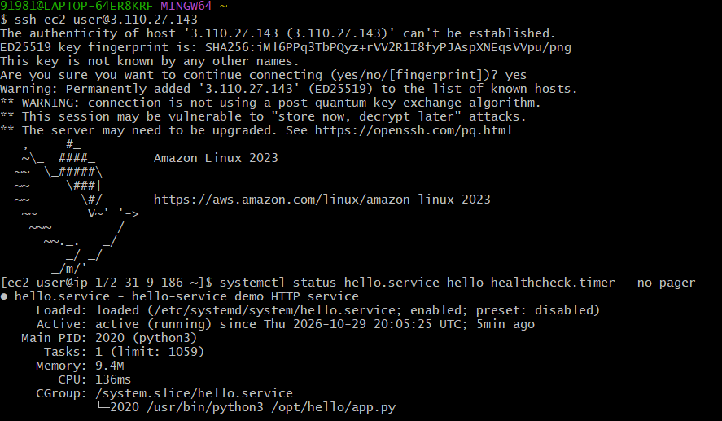

# hello-service

A small HTTP service deployed to one free-tier AWS EC2 instance with Terraform,
kept alive by systemd, checked by a health-check timer, and validated by
GitHub Actions.

| Endpoint | Response |
|---|---|
| `GET /` | `Hello from hello-service!` |
| `GET /health` | `{"status": "ok", "uptime_seconds": 42}` |

**Docs:** [Architecture / request path](docs/architecture.md) ·
[Operations note (outage checklist)](docs/operations.md) ·
[Example CI output](docs/ci-output.md) ·
[Evidence](docs/evidence.md)

## Repository layout

```
app/app.py                      the service (Python standard library only)
app/test_app.py                 unit tests
deploy/hello.service            systemd unit: runs the app, restarts on crash, starts on boot
deploy/healthcheck.sh           probes /health, restarts the service, logs the result
deploy/hello-healthcheck.*      systemd timer + unit that run the check every minute
terraform/                      EC2 instance, security group, key pair, cloud-init script
scripts/deploy.sh               one-command deploy (prereq checks → apply → wait → verify)
scripts/verify.sh               endpoint checks, used locally, after deploy and in CI
.github/workflows/ci.yml        CI: tests, shellcheck, smoke test, terraform fmt/validate, live check
```

## How it meets the requirements

| Requirement | Implementation |
|---|---|
| Small Linux instance, free tier | One `t3.micro`, Amazon Linux 2023, default VPC, 8 GiB gp3 |
| Starts after restart | `systemctl enable` for the service and the timer |
| Only the required public port | Security group: TCP 80 from anywhere; nothing else public |
| Admin access restricted | SSH (22) only from your own `/32`, key-only login, IMDSv2 required |
| Detects unavailability | `Restart=always` for crashes + 1-minute `/health` probe that restarts and logs |
| Automated deploy | Terraform + cloud-init, wrapped by `bash scripts/deploy.sh` |
| CI | GitHub Actions: tests, lint, smoke test, `terraform validate`, optional live check |

## Prerequisites

- An AWS account on the Free Tier, and an IAM user (not root) with access keys
  allowed to manage EC2.
- [Terraform](https://developer.hashicorp.com/terraform/install) ≥ 1.5
- [AWS CLI v2](https://docs.aws.amazon.com/cli/latest/userguide/getting-started-install.html), configured with `aws configure`
- `bash`, `curl`, `ssh` (Linux/macOS terminal, or WSL / Git Bash on Windows)
- Python 3.9+ (only for running locally)
- An SSH key: `ssh-keygen -t ed25519` (creates `~/.ssh/id_ed25519.pub`)

Check that the instance type is free-tier eligible for **your** account:

```bash
aws ec2 describe-instance-types --region ap-south-1 \
  --filters Name=free-tier-eligible,Values=true \
  --query "InstanceTypes[].InstanceType" --output text
```

If `t3.micro` is not listed, set `instance_type` in `terraform/terraform.tfvars`
to one that is.

## Run locally (no cloud needed)

```bash
python3 app/app.py                      # listens on :8080
bash scripts/verify.sh http://127.0.0.1:8080 # in a second terminal
cd app && python3 -m unittest -v        # unit tests
```

## Setup / deploy to AWS

```bash
bash scripts/deploy.sh
```

The script:
1. checks `terraform`, `aws`, `curl` and your AWS credentials,
2. detects your public IP and writes `admin_cidr = "<ip>/32"` to
   `terraform/terraform.tfvars` (gitignored),
3. runs `terraform init` and `terraform apply` (you type `yes` to approve),
4. waits up to 5 minutes for first boot, then runs `bash scripts/verify.sh`.

Manual equivalent:

```bash
cd terraform
echo 'admin_cidr = "<your-ip>/32"' > terraform.tfvars
terraform init
terraform apply
terraform output
```

## Validation

```bash
bash scripts/verify.sh "$(terraform -chdir=terraform output -raw service_url)"
```

Prove the self-healing and restart behaviour (SSH in with the `ssh_command` output):

```bash
# 1. Crash: systemd restarts it within ~3 s
sudo systemctl kill -s SIGKILL hello.service; sleep 5; systemctl is-active hello.service

# 2. Hang: process alive but frozen; the health check restarts it within ~1-2 min
sudo systemctl kill -s SIGSTOP hello.service
journalctl -t hello-healthcheck -f      # wait for FAIL ... then RECOVERED

# 3. Reboot: service is back after boot
sudo reboot     # then, from your laptop: bash scripts/verify.sh http://<ip>
```

Prove the network restrictions (from your laptop):

```bash
curl --max-time 5 http://<ip>:8080/   # times out: port not open
nc -vz -w 5 <ip> 22                   # succeeds only from your IP
```

## CI

`.github/workflows/ci.yml` runs on every push and pull request:

- **app**: Python syntax check, unit tests, ShellCheck, and a smoke test that
  starts the service and runs `bash scripts/verify.sh` against it.
- **terraform**: `terraform fmt -check`, `init -backend=false`, `validate`
  (no AWS credentials needed).
- **live-check**: runs `bash scripts/verify.sh` against the deployed instance when
  the repository variable `SERVICE_URL` is set (Settings → Secrets and
  variables → Actions → Variables). Unset it after cleanup.

No cloud credentials are stored in the repository; deployment is done from
the operator's machine. See [docs/ci-output.md](docs/ci-output.md) for an example run.

## Cleanup

```bash
terraform -chdir=terraform destroy
```

Type `yes`. This removes the instance, security group and key pair. Then
delete the `SERVICE_URL` repository variable so the live check stops running.
Confirm in the EC2 console that no instances or volumes remain.

## Troubleshooting

| Symptom | Likely cause | Fix |
|---|---|---|
| `deploy.sh`: AWS credentials not working | CLI not configured / expired keys | `aws configure`, then `aws sts get-caller-identity` |
| `Invalid value for "path"` on `ssh_public_key_path` | No SSH key | `ssh-keygen -t ed25519`, or set the path in `terraform.tfvars` |
| `no matching EC2 VPC found` | Default VPC was deleted | Recreate it: `aws ec2 create-default-vpc` |
| `InvalidKeyPair.Duplicate` / `InvalidGroup.Duplicate` | Leftovers from an earlier run without state | Delete them in the console or change `name` in `terraform.tfvars` |
| Instance type not eligible / `Unsupported` | Type not free for this account or region | Use a type listed by the command in Prerequisites |
| Not healthy after 5 minutes | First boot failed | SSH in: `sudo cat /var/log/cloud-init-output.log`, `systemctl status hello` |
| HTTP times out, SSH works | Security group / wrong IP | `terraform output`; check port 80 rule |
| SSH times out, HTTP works | Your IP changed | Update `admin_cidr` in `terraform.tfvars`, `terraform apply` |
| `Permission denied (publickey)` | Wrong user or key | User is `ec2-user`; use `-i ~/.ssh/id_ed25519` |
| CI `terraform fmt` fails | Formatting | `terraform -chdir=terraform fmt` and commit |

For a full outage checklist see [docs/operations.md](docs/operations.md).

## Assumptions and limitations

- **One instance, no load balancer**: a single point of failure, accepted to
  stay in the free tier. Production would use an Auto Scaling group behind a
  load balancer with health checks.
- **HTTP only**: no TLS, because there is no domain. Production would add a
  domain and HTTPS (load balancer + ACM certificate, or Caddy/Let's Encrypt).
- **Public IP changes** if the instance is stopped/started (no Elastic IP).
- **SSH restricted by IP, not removed**: the tightest option that stays simple.
  AWS Systems Manager Session Manager would allow closing port 22 entirely, at
  the cost of an IAM role and instance profile.
- **Failures are logged, not alerted**: the health check writes to journald.
  Production would send logs/metrics to CloudWatch with an alarm, or use an
  external uptime monitor.
- **Local Terraform state**: fine for one operator. A team would use a remote
  backend (S3 + locking).
- **Deploy = replace instance**: changing the app replaces the instance
  (brief downtime, new IP). Acceptable for a demo; production would roll out
  through an image pipeline or configuration management.
- **CI does not deploy**: credentials and approval stay with the operator, as
  the brief allows. CI validates code and configuration and can check the live endpoint.
- Free-tier eligibility depends on the account's age and plan; the instance
  type is a variable for that reason. Destroy resources when finished.

## Evidence

Screenshots and terminal output from the deployed instance (service status,
crash restart, hang recovery, reboot, network restrictions) are in
[docs/evidence.md](docs/evidence.md); the CI run is in
[docs/ci-output.md](docs/ci-output.md).


