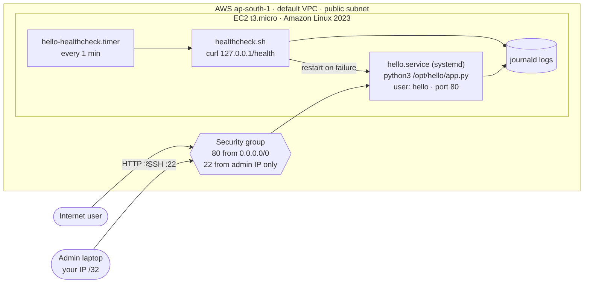

# Architecture and request path

## Request path (in words)

1. A client sends `GET http://<public-ip>/` (or `/health`).
2. The request reaches the instance's public IPv4 address in the default VPC.
3. The **security group** allows it because TCP 80 is open to `0.0.0.0/0`.
   Every other port is dropped. SSH (TCP 22) is accepted only from the
   admin's own IP (`admin_cidr`, a single `/32`).
4. On the instance, **`hello.service`** (a systemd unit) runs
   `python3 /opt/hello/app.py` as the unprivileged `hello` user. It may bind
   port 80 because systemd grants only `CAP_NET_BIND_SERVICE`.
5. The app answers `/` with a text message and `/health` with
   `{"status": "ok", "uptime_seconds": N}`. Each request is logged to stdout,
   which systemd stores in journald.

## How the service stays up

| Failure | What handles it |
|---|---|
| Process crashes or is killed | `Restart=always` in `hello.service` restarts it after 3 s |
| Process alive but not answering (hung) | `hello-healthcheck.timer` runs `healthcheck.sh` every minute; two failed probes → `systemctl restart hello.service`, result logged |
| Instance reboots | Both units are `enabled`, so systemd starts them on boot |
| Still down after restart | Health check logs `STILL DOWN` at error priority and exits 1 (visible in `systemctl status hello-healthcheck`) |

## How it is deployed

`scripts/deploy.sh` → `terraform apply` creates a key pair, a security group
and one EC2 instance. Terraform renders `terraform/user_data.sh.tftpl` with
the app and unit files embedded; cloud-init runs it once at first boot. A
change to any of those files makes Terraform replace the instance.
