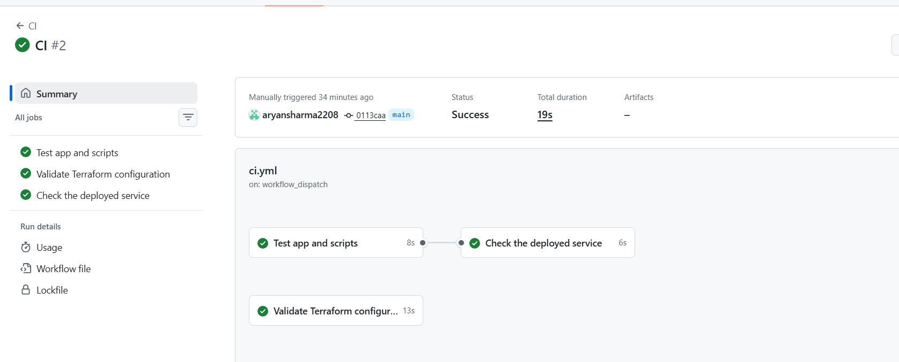
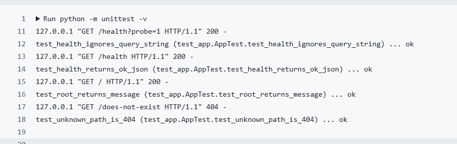
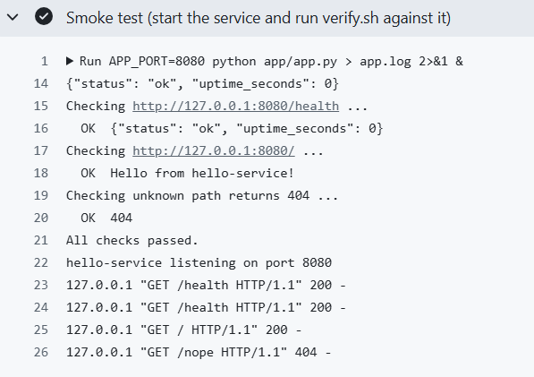
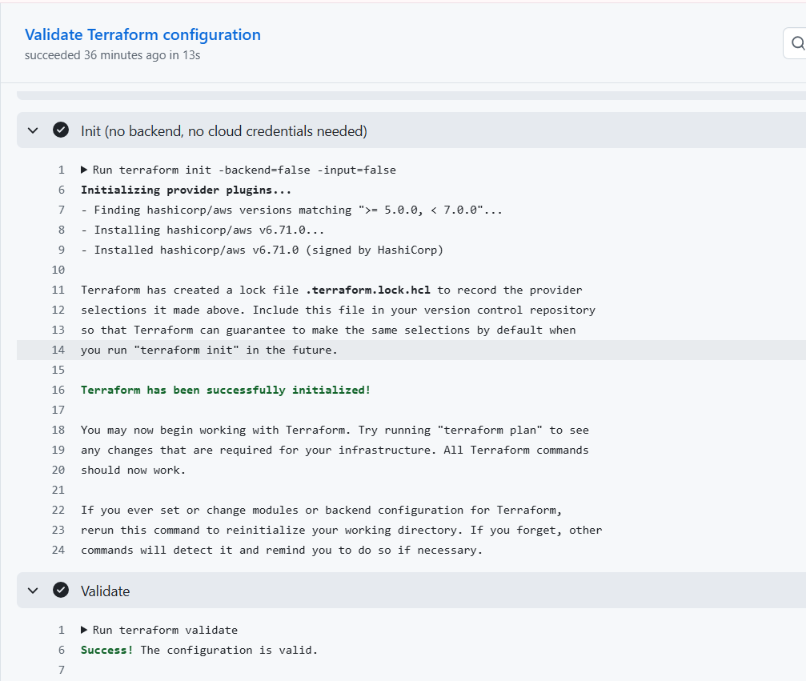

# Example CI output

Workflow: `.github/workflows/ci.yml`. The latest runs are on the repository's **Actions** tab.

Run link: <https://github.com/aryansharma2208/msd_assignment/actions/runs/40948219096>

## Run summary

All three jobs passed: app tests, Terraform validation, and the live check
against the deployed instance.

## Log excerpts

Unit tests:

Smoke test (service started in CI and checked with `scripts/verify.sh`):

Terraform init and validate:

