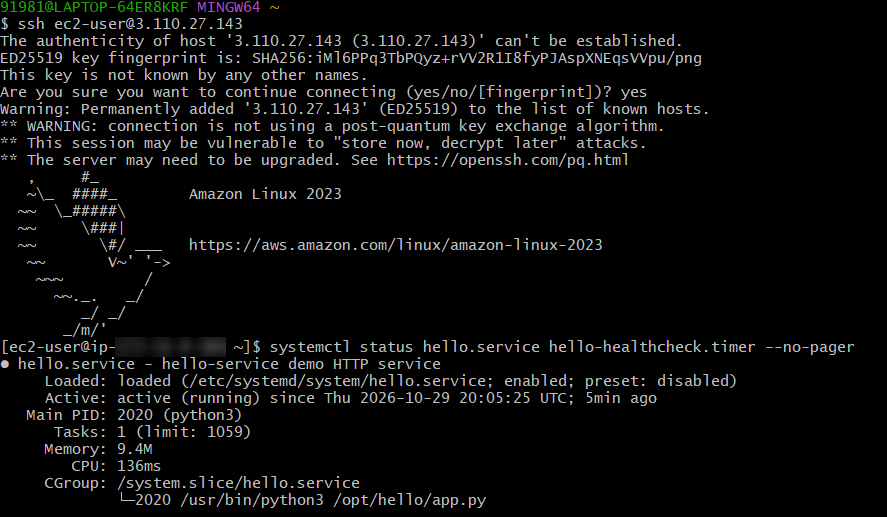
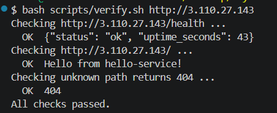
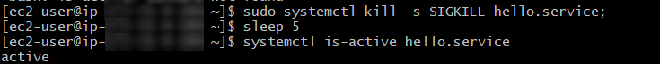
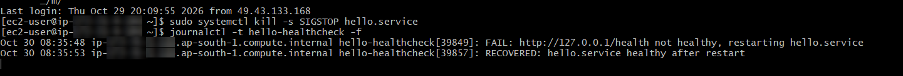
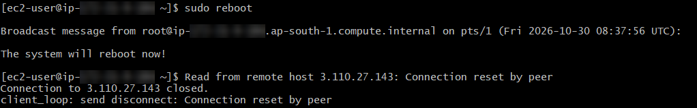
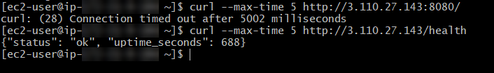

# Evidence

Proof that the deployed instance (`t3.micro`, Amazon Linux 2023, ap-south-1)
behaves as the README claims. Captured on 2026-10-29 and 2026-10-30 against
`http://3.110.27.143` (the IP changes on every new deploy).

## 1. Service is running under systemd

## 2. Endpoints answer from the internet

`scripts/verify.sh` run from the admin laptop against the public IP:

## 3. Crash: systemd restarts the process

`SIGKILL` the service; 5 seconds later it is active again (`Restart=always`).

## 4. Hang: the health check detects it and restarts the service

The process is frozen with `SIGSTOP`, so it is still "running" but answers
nothing, and systemd alone would not notice. The 1-minute timer probes
`/health`, logs `FAIL`, restarts the service and logs `RECOVERED` once it
answers again. An earlier timed run took 78 s from freeze to recovery.

## 5. Reboot: the service starts on boot

The instance is rebooted at 08:37:56 UTC:

After the reboot, `verify.sh` passes again with no manual action. The low
`uptime_seconds` (43) shows this is a fresh process started by systemd at boot:

## 6. Network restrictions

Requests to the instance's own public IP leave through the internet gateway and
come back in through the security group, so the firewall rules apply. Port 8080
**times out**: the security group drops the packets, so the connection is never
even refused. Port 80, the only public port, answers:

A port probe from the admin laptop (`49.43.133.168`, the `admin_cidr`) gave the
same picture: 22 and 80 open, 8080 and 3306 filtered. SSH is open only to that
`/32`.

## 7. CI

See [ci-output.md](ci-output.md) for the green GitHub Actions run.
